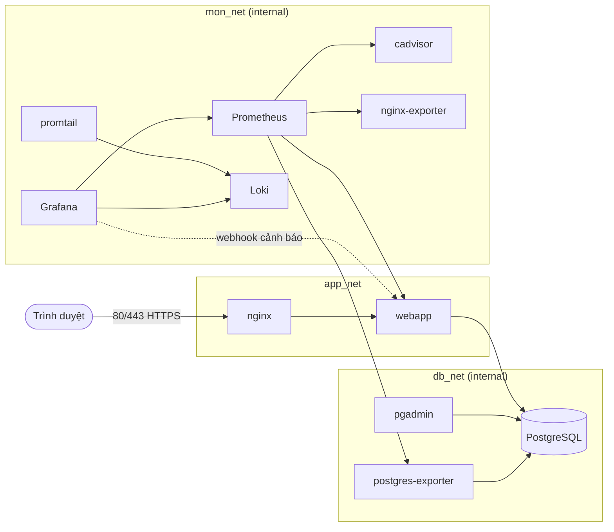

# Sổ Việc: quản lý công việc nhóm bằng Docker Compose

- Sinh viên: Đồng Quốc Khánh. MSSV: DTC245200637. Lớp: CNTT K23C.
- Môn: Triển khai và Quản trị Hệ thống Phần mềm. Đề 24: Hệ thống Quản lý Công việc / Task Tracker.
- Cơ sở dữ liệu: PostgreSQL + pgAdmin.

Sổ Việc là bảng ba cột (Cần làm, Đang làm, Xong) để nhóm làm bài tập lớn chia việc. Mỗi việc có hạn, mức ưu tiên và người làm. Việc quá hạn được tô màu.
Toàn bộ hệ thống chạy bằng một lệnh `docker compose up -d`.

## 1. Kiến trúc



| Dịch vụ | Vai trò | Địa chỉ trên máy chủ |
|---|---|---|
| nginx | Reverse proxy, HTTPS tự ký, security headers, giới hạn tốc độ đăng nhập | https://localhost (cổng 80 chuyển sang 443) |
| webapp | Ứng dụng Node.js (Express + EJS), có `/metrics` và log JSON | Không mở ra ngoài |
| db | PostgreSQL 16 | Không mở ra ngoài |
| pgadmin | Công cụ quản lý PostgreSQL | http://127.0.0.1:5050 |
| prometheus | Thu thập số liệu | http://127.0.0.1:9090 |
| grafana | Dashboard và cảnh báo | http://127.0.0.1:3000 |
| cadvisor, nginx-exporter, postgres-exporter | Nguồn số liệu cho Prometheus | Chỉ trong mạng `mon_net` |
| loki, promtail | Gom log của mọi container | Chỉ trong mạng `mon_net` |

## 2. Chạy hệ thống

Cần Docker Engine và Docker Compose v2. Trên Windows, chạy các script bằng Git Bash hoặc WSL.

```bash
git clone https://github.com/hieu-kiien/DTC245200637.git
cd DTC245200637
./scripts/gen-secrets.sh      # tạo .env với mật khẩu ngẫu nhiên
./scripts/gen-certs.sh        # tạo chứng chỉ HTTPS tự ký
docker compose up -d --build
docker compose ps             # mọi dịch vụ phải ở trạng thái running / healthy
```

Tài khoản quản trị Sổ Việc là `ADMIN_USERNAME` và `ADMIN_PASSWORD` trong `.env`. Mật khẩu Grafana và pgAdmin cũng ở đó.
Trình duyệt sẽ báo chứng chỉ không tin cậy vì tự ký. Chọn tiếp tục truy cập.

**Kết nối pgAdmin:** đăng nhập bằng `PGADMIN_EMAIL` và `PGADMIN_PASSWORD`. Server "Sổ Việc (PostgreSQL)" đã có sẵn. Mật khẩu là `DB_SUPERPASS`.

Dừng hệ thống: `docker compose down`. Xóa cả dữ liệu: `docker compose down -v`.

## 3. Giám sát bằng Prometheus và Grafana

Mở http://127.0.0.1:3000, đăng nhập `GRAFANA_ADMIN_USER` / `GRAFANA_ADMIN_PASSWORD`. Dashboard **Giám sát hệ thống** nằm trong thư mục "Sổ Việc" và là trang chủ mặc định. Dashboard gồm:

- Trạng thái chạy của web, Nginx, PostgreSQL, cAdvisor.
- CPU, RAM, mạng của từng container (cAdvisor).
- Kết nối Nginx, request và độ trễ p95 của ứng dụng.
- Kết nối, giao dịch và dòng dữ liệu của PostgreSQL.

Trang http://127.0.0.1:9090/targets phải hiện 5 target ở trạng thái UP.

## 4. Log tập trung bằng Loki và LogQL

Promtail đọc log của mọi container trong project và gắn nhãn `job` bằng tên dịch vụ. Nginx và webapp ghi log dạng JSON. Mở Grafana, vào **Explore**, chọn nguồn **Loki**:

```logql
# 1. Mọi request Nginx trả lỗi 5xx
{job="nginx"} | json | status >= 500

# 2. Lỗi và cảnh báo trong ứng dụng
{job="webapp"} | json | level=~"warn|error"

# 3. Số lần đăng nhập sai mỗi phút
sum(count_over_time({job="webapp"} | json | event="login_failed" [1m]))

# 4. Đếm theo IP nguồn và tài khoản bị nhắm tới trong 15 phút
sum by (ip, user) (count_over_time({job="webapp"} | json | event="login_failed" [15m]))
```

Dashboard **Nhật ký và an toàn thông tin** gom các truy vấn này vào một màn hình.

## 5. Sự cố an toàn thông tin: dò mật khẩu, cảnh báo, truy vết

Kịch bản: một IP thử mật khẩu liên tiếp vào tài khoản `admin`.

```bash
./scripts/simulate-bruteforce.sh https://localhost 15
```

Diễn biến:

1. Nginx cho 6 request đầu đi qua (giới hạn 10 lần/phút/IP, burst 5). Ứng dụng trả 401 và ghi `login_failed`. Các request sau bị Nginx chặn bằng 429.
2. Promtail đẩy log về Loki. Quy tắc **Dò mật khẩu - nhiều lần đăng nhập sai** (từ 5 lần trong 2 phút) chuyển sang **Firing**. Xem tại Grafana, mục Alerting, Alert rules.
3. Grafana gửi webhook tới `webapp:/internal/alert-hook`. Ứng dụng ghi dòng `alert_received` vào log.
4. Truy vết trong Explore:

```logql
{job="webapp"} | json | event=~"login_failed|alert_received"
{job="nginx"} | json | uri="/login" | method="POST" | status=~"401|429"
```

Kết quả cho biết IP nguồn, tài khoản bị nhắm tới, thời điểm bắt đầu, thời điểm cảnh báo bắn và số request bị Nginx chặn.

## 6. Hardening đã áp dụng

| Biện pháp | Cách làm | Kiểm tra |
|---|---|---|
| Container không chạy bằng root | `webapp`: `USER node`. `nginx`: image nginx-unprivileged. `db`: `user: 70:70`. | `./scripts/verify-hardening.sh`, mục 1 |
| Hệ thống tệp chỉ đọc, bỏ hết capability | `read_only`, `cap_drop: ALL`, `no-new-privileges` cho webapp và nginx | Mục 2 |
| Cô lập mạng | `db_net` và `mon_net` là `internal: true`. DB không publish cổng. Nginx không với tới DB. | Mục 3 và 4 |
| Mật khẩu mạnh, không nằm trong mã nguồn | `gen-secrets.sh` sinh chuỗi ngẫu nhiên vào `.env` (quyền 600, đã `.gitignore`) | Mục 8 |
| Quyền tối thiểu trong DB | `soviec_app` chỉ SELECT, INSERT, UPDATE, DELETE. `soviec_exporter` chỉ có `pg_monitor`. | Mục 7 |
| Security headers và TLS | HSTS, X-Frame-Options, X-Content-Type-Options, X-XSS-Protection, CSP, Referrer-Policy, Permissions-Policy. TLS 1.2 và 1.3. Ẩn phiên bản Nginx. | Mục 5 |
| Chặn dò mật khẩu | `limit_req` 10 lần/phút/IP cho `POST /login`, ứng dụng dùng bcrypt, có CSRF token | Mục 5 |
| Cổng quản trị chỉ ở localhost | pgAdmin, Grafana, Prometheus bind `127.0.0.1` | Mục 3 |

Hai chỗ chưa siết hết: Promtail đọc `docker.sock` ở chế độ chỉ đọc, và pgAdmin không dùng `read_only` vì cần ghi dữ liệu phiên làm việc.

## Cấu trúc thư mục

```
app/            Mã nguồn Node.js, Dockerfile
db/init/        Lược đồ và phân quyền PostgreSQL (chạy lần đầu)
nginx/          nginx.conf, conf.d/default.conf, certs/
monitoring/     prometheus.yml, Grafana provisioning và dashboard
logging/        loki-config.yaml, promtail-config.yaml
scripts/        gen-secrets, gen-certs, simulate-bruteforce, verify-hardening
```

## Lịch sử 3 commit

1. Ứng dụng + PostgreSQL + pgAdmin + Nginx reverse proxy (HTTPS tự ký, security headers).
2. Prometheus + Grafana (cAdvisor, nginx-exporter, postgres-exporter, dashboard).
3. Loki + Promtail, LogQL, cảnh báo Grafana, kịch bản sự cố, script kiểm tra hardening.

## Sự cố thường gặp

- **Cổng 80 hoặc 443 đã bị dùng:** đổi vế trái ở mục `ports` của `nginx` trong `docker-compose.yml`, ví dụ `"8080:8080"` và `"8443:8443"`.
- **`db` báo permission denied khi khởi động:** xóa dòng `user: "70:70"` của dịch vụ `db`, rồi `docker compose down -v` và chạy lại.
- **Nginx báo không đọc được `server.key`:** chạy lại `./scripts/gen-certs.sh`.
- **cAdvisor không có số liệu trên Docker Desktop:** kiểm tra mục Resources và bật WSL 2 backend.
